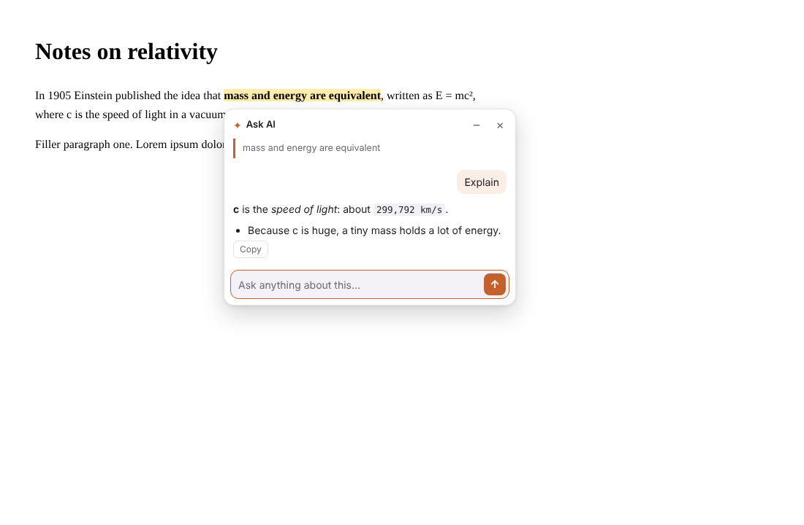
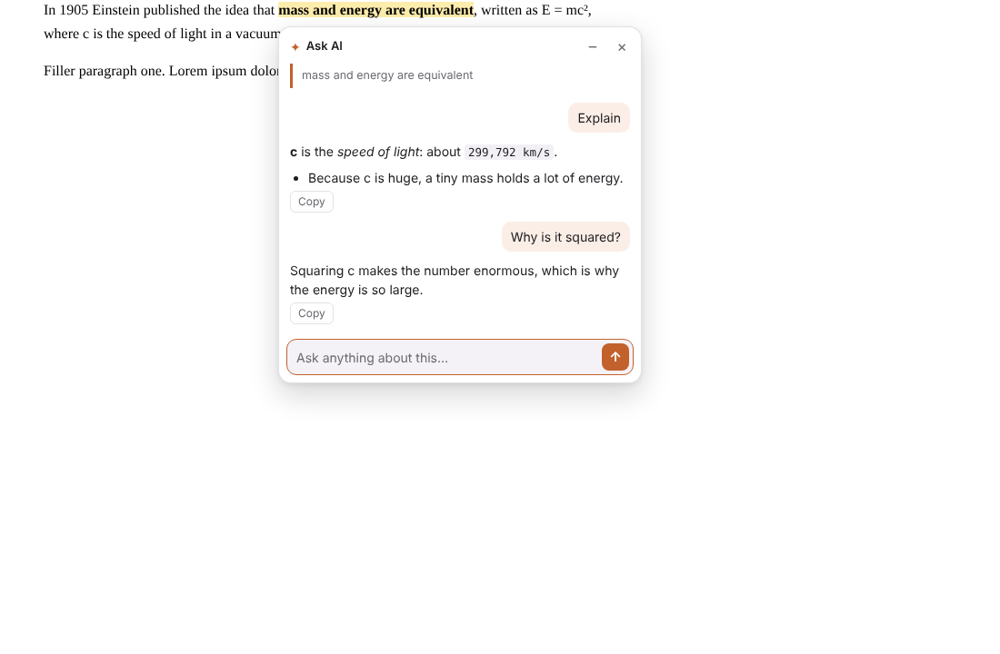

# ✦ AskHere

**Highlight any text → click "Ask AI" → the answer pops up right next to it.**

No copying into another tab. No scrolling down to the bottom of a chat and back up again. Your place on the page stays exactly where it was.



## Why

When you're reading something long, like an AI chat answer, docs, or an article, and one sentence confuses you, today you have to:

1. copy the text,
2. scroll to the chat box at the bottom (or switch tabs),
3. ask, read the answer,
4. scroll back and find where you were.

AskHere turns that into one click. The answer appears in a small panel **anchored to the text you highlighted**, and it stays glued to that text as you scroll. You can ask follow-ups in the same panel, keep several side questions open at once, and close them when you're done. Your main conversation stays clean.

## Features

- **Ask AI button** appears when you select text, on any website.
- **Panel next to the text** that follows it when you scroll, even inside chat apps that scroll an inner container.
- **Follow-up questions** in the same panel, with the highlighted text and surrounding paragraph as context.
- **Quick actions:** Explain · Simplify · Example · Summarize · Why?
- **Select text inside an answer** to ask about that part, the same way.
- **Several panels at once.** Drag them, minimize them to a small ✦ dot, and close with `Esc`.
- **Streaming answers** with safe Markdown rendering, plus a stop button and copy.
- **Claude or ChatGPT.** Bring your own API key.
- Keyboard shortcut **Alt+Shift+A** and a **right-click → Ask AI** menu.
- Light and dark mode. The highlighted text gets a soft yellow mark while its panel is open.
- Optionally show the button only while holding **Alt**, or turn it off on specific sites.



## Install (from source, takes 1 minute)

1. Download this repo: **Code → Download ZIP**, then unzip it. Or run:
   ```bash
   git clone https://github.com/MeetM0/askhere.git
   ```
2. Open `chrome://extensions` (also works in Edge, Brave, Arc and other Chromium browsers).
3. Turn on **Developer mode** (top right).
4. Click **Load unpacked** and pick the `extension` folder.
5. The settings page opens. Paste your API key:
   - **Claude:** [console.anthropic.com/settings/keys](https://console.anthropic.com/settings/keys)
   - **ChatGPT / OpenAI:** [platform.openai.com/api-keys](https://platform.openai.com/api-keys)
6. Click **Test connection**, then go highlight something.

## Privacy

- Your API key is stored only in this browser (`chrome.storage.local`). It is never synced and never sent anywhere except the provider you picked.
- Text is sent **only when you click Ask AI** (or use the shortcut or menu). The request includes the highlighted text, a bit of the surrounding paragraph, the page title and the URL.
- No analytics, no servers of our own. The code is all here for you to read.

## Settings

| Setting | Default | Notes |
| --- | --- | --- |
| Provider | Claude | Claude or OpenAI |
| Claude model | Claude Opus 5.5 | Sonnet 5.5 and Haiku 5.5 are faster and cheaper; any model ID works |
| Thinking effort (Claude) | Low | Low keeps quick answers fast. Raise it for harder questions |
| OpenAI model | `gpt-5` | Any chat-completions model ID |
| Answer length | Concise | or Detailed |
| Custom instructions | none | e.g. "Answer in Hindi", "I'm a beginner" |
| Button | On every selection | or Alt + select, or off |
| Disabled sites | none | Hides the button on those domains |

## Development

No build step. The `extension/` folder is the extension.

```bash
npm test            # unit tests: markdown renderer, SSE parser, prompt builder
npm run test:e2e    # loads the extension in Chromium with a mocked API and clicks through it
npm run zip         # packages extension/ into askhere.zip for the Chrome Web Store
```

See [CONTRIBUTING.md](CONTRIBUTING.md) for the project layout.

## Roadmap

- [ ] Firefox build
- [ ] Remember panels per page, so you can come back to your side questions later
- [ ] "Send this side thread back to the main chat" on ChatGPT, Claude and Gemini
- [ ] Local models through Ollama
- [ ] Desktop app (Windows/macOS) that works in any app, not just the browser

Ideas and PRs are welcome. Open an issue.

## License

[MIT](LICENSE)
