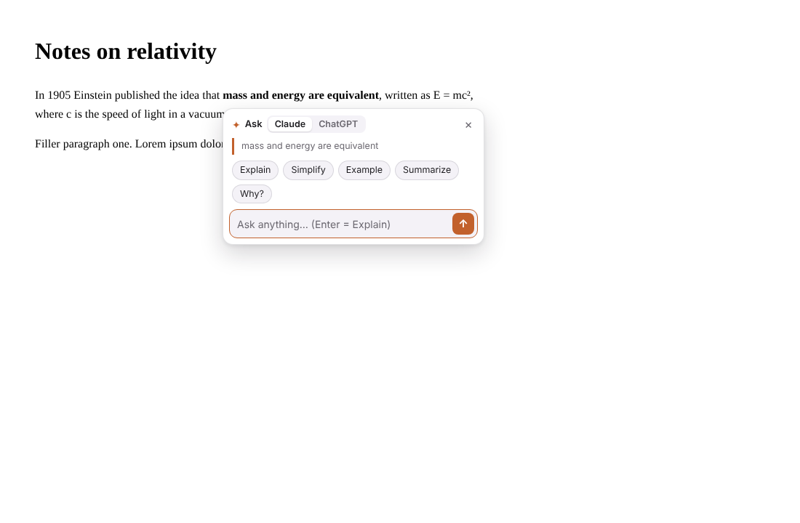

# ✦ AskHere

**Highlight any text → click "Ask AI" → your own Claude or ChatGPT opens in a small window right next to it, with the question already sent.**

No API key. No extra cost. It uses the Claude or ChatGPT account you're already logged in to, the same as if you'd opened it yourself. You never lose your place on the page.



## Why

When you're reading something long, like an AI chat answer, docs, or an article, and one sentence confuses you, today you have to:

1. copy the text,
2. scroll to the chat box at the bottom (or switch tabs),
3. paste, ask, read the answer,
4. scroll back and find where you were.

AskHere turns that into one click. Your main conversation stays clean: each side question gets its own chat in a small window placed beside the text you asked about.

## How it works

1. Select text on any website. A **✦ Ask AI** button appears.
2. Click it. A small box opens next to the text. Pick **Explain / Simplify / Example / Summarize / Why?** or type your own question.
3. A small **claude.ai** (or **chatgpt.com**) window opens right next to the text. AskHere types your question, including the quoted text, and presses send.
4. Ask follow-ups right there in that window. The next time you ask about something, the same window moves next to the new text.

## Features

- Works on **any website**, including inside Claude and ChatGPT themselves.
- **Automatic AI choice:** reading on chatgpt.com opens ChatGPT, reading on claude.ai opens Claude, and everywhere else uses your default. You can switch per question.
- **No API key.** It just opens the normal site with your login: Free, Pro, Plus, Team, whatever you have.
- The window is placed **below, above or beside the text**, whichever fits on screen, and kept on screen.
- **One reusable window** by default, so you don't end up with a pile of windows.
- Keyboard shortcut **Alt+Shift+A** and **right-click → Ask AI**.
- Optional text added to every question (for example "Answer briefly." or "Answer in Hindi.").
- Turn off auto-send if you'd rather review the question first.
- Show the button only while holding **Alt**, or hide it on specific sites.
- Light and dark mode.

## Install (from source, takes 1 minute)

1. Download this repo: **Code → Download ZIP**, then unzip it. Or run:
   ```bash
   git clone https://github.com/MeetM0/askhere.git
   ```
2. Open `chrome://extensions` (also works in Edge, Brave, Arc and other Chromium browsers).
3. Turn on **Developer mode** (top right).
4. Click **Load unpacked** and pick the `extension` folder.
5. Make sure you're logged in at [claude.ai](https://claude.ai) and/or [chatgpt.com](https://chatgpt.com).
6. Highlight something and click **✦ Ask AI**.

## Privacy

- AskHere has **no servers and no analytics**. It doesn't call any AI API.
- When you ask, it opens claude.ai or chatgpt.com and types your question there. The question includes the highlighted text, the page title and the URL. That's exactly what you'd be sending if you copy-pasted it yourself, under your account's usual settings.
- Nothing is sent until you click Ask (or use the shortcut or menu).

## Good to know

- Auto-send works by finding the chat box on claude.ai / chatgpt.com. If those sites change their page, auto-send can break. When that happens, your question is copied so you can paste it, and the fix is usually a one-line selector update in [`extension/inject.js`](extension/inject.js). Issues and PRs are welcome.
- If you're not logged in, log in inside the window and your question is sent automatically, as long as you do it within 10 minutes.
- Browsers don't let extensions keep a window "always on top". If you click back on the page, the AI window may go behind it. Click **Ask AI** again, or use the shortcut, to bring it back next to your text.

## Settings

| Setting | Default | Notes |
| --- | --- | --- |
| Which AI | Automatic | Matches the site you're on, otherwise your default |
| Default AI | Claude | or ChatGPT |
| Window size | Medium (520 × 720) | Small / Medium / Large |
| Reuse one window | On | Moves the window to each new question |
| Send automatically | On | Off = the question is typed in but not sent |
| Add to every question | none | e.g. "Answer briefly." |
| Ask AI button | On every selection | or Alt + select, or off |
| Disabled sites | none | Hides the button on those domains |

## Development

No build step. The `extension/` folder is the extension.

```bash
npm test            # unit tests: window placement, prompt, AI choice
npm run test:e2e    # loads the extension in Chromium and runs the full flow against a fake claude.ai page
npm run zip         # packages extension/ into askhere.zip for the Chrome Web Store
```

See [CONTRIBUTING.md](CONTRIBUTING.md) for the project layout.

## Roadmap

- [ ] Gemini support
- [ ] Firefox build
- [ ] Optional side-panel mode (AI docked at the side of the browser)
- [ ] Desktop app (Windows/macOS) that works in any app, not just the browser

## License

[MIT](LICENSE)
